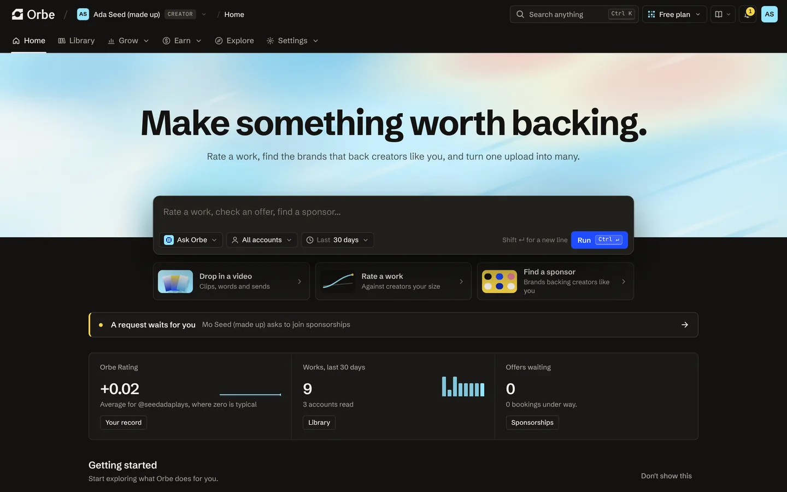

I build AI agents that do real work, end to end. London.

**[Orbe](https://eoinforker.github.io/orbe-site/)**: the creator's side of sponsorship deals. Brands are getting agents; creators get Orbe. It negotiates every offer inside the creator's rules, waits for one tap on anything binding, and holds the brand's money until delivery is proven. Managers run it across a whole roster. [Try the demo](https://eoinforker.github.io/orbe-site/demo/) (sample data, not live yet).
 

**[immiscible](https://immiscible.ai)**: rules, approvals and a signed record for what AI agents spend and do. Live in alpha, with SDKs on npm and PyPI.
 

**[idyll](https://idyll.day)**: social without the scroll. Coming soon.
 

Before: AI tools and due diligence at [Alumni Ventures](https://av.vc), creator partnerships at [Electrify](https://www.electrify.video), and [Surreal Recordings](https://surrealrecordings.bandcamp.com), a label I co-founded at 16.
